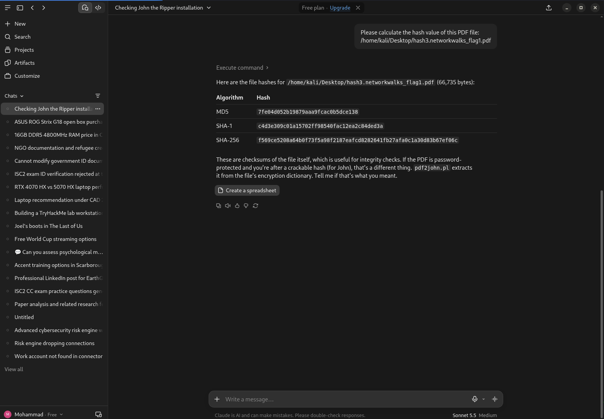
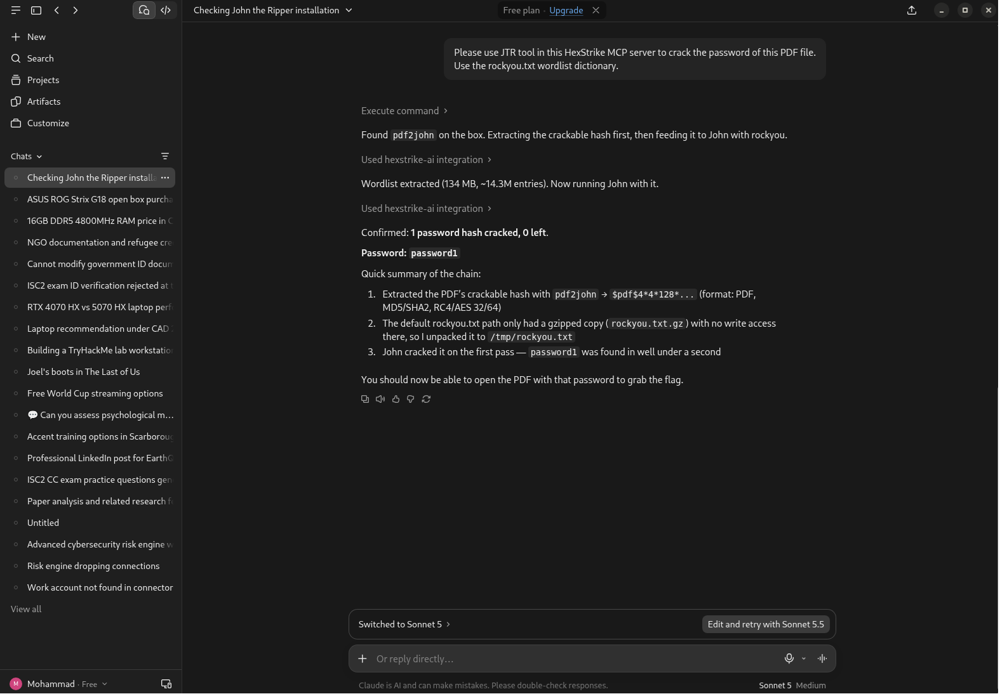

# AI\-Assisted Password Cracking with Claude Desktop, HexStrike MCP & JTR

## Overview

This project demonstrates an AI\-assisted password recovery workflow using Claude Desktop, HexStrike MCP, and John the Ripper (JTR) on Kali Linux.

The objective was to recover the password of a protected PDF file by allowing Claude to interact with cybersecurity tools through the Model Context Protocol (MCP).

---

## Technologies Used

- Kali Linux
- Claude Desktop
- HexStrike MCP
- John the Ripper (JTR)
- RockYou Wordlist
- PDF Hash Extraction Tools

---

## Skills Demonstrated

- AI\-Assisted Cybersecurity Operations
- MCP (Model Context Protocol)
- Claude Desktop Integration
- Password Recovery
- PDF Hash Analysis
- John the Ripper (JTR)
- Linux Tool Orchestration

---

## Lab Workflow

### Step 1 \- PDF Analysis

Claude Desktop analyzed the target PDF file through HexStrike MCP and calculated the file hashes.

### Step 2 \- AI\-Assisted Password Recovery

Using HexStrike MCP, Claude automatically:

- Identified the correct tools
- Extracted the PDF hash
- Utilized the RockYou wordlist
- Executed John the Ripper
- Recovered the PDF password

Recovered password:

password1

### Step 3 \- Validation

The recovered password was successfully used to open the protected PDF and retrieve the challenge flag.

---

## Evidence

### PDF Analysis

### Password Successfully Recovered

### Challenge Flag Captured

---

## Key Takeaways

This lab demonstrates how AI can orchestrate cybersecurity tools through MCP integrations instead of requiring manual execution of every command.

Traditional workflow:

User

↓

pdf2john

↓

John the Ripper

↓

Password Recovery

AI\-assisted workflow:

User

↓

Claude Desktop

↓

HexStrike MCP

↓

John the Ripper

↓

Password Recovery

The AI agent does not replace security tools; it acts as an intelligent interface that automates tool selection and execution.

---

## Educational Disclaimer

This project was completed in an authorized cybersecurity training environment for educational purposes only. No unauthorized systems or third\-party assets were targeted.

